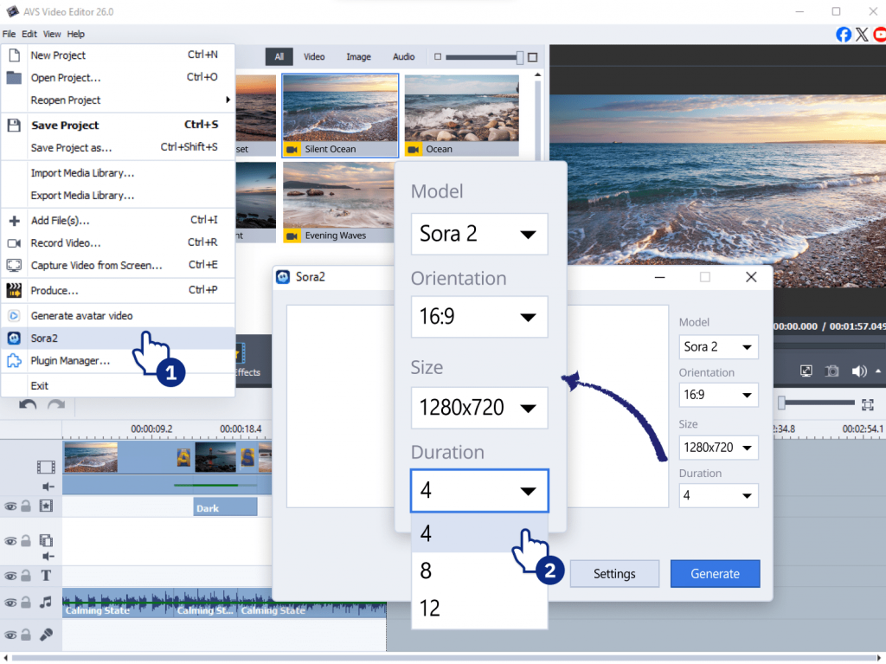
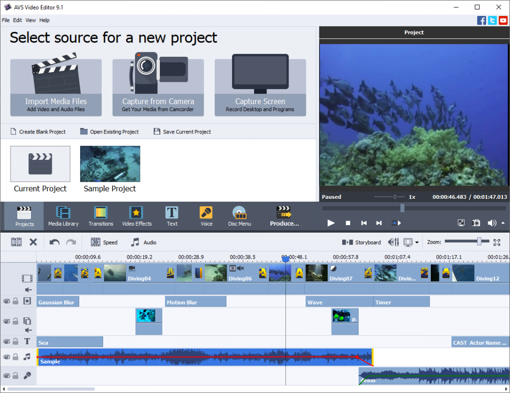

# AVS Video Editor for Timeline Editing and Effects

AVS Video Editor combines clip editing, transitions, visual effects, and export tools for Windows.
AVS Video Editor Effects can help establish a visual style after the timing and structure of a sequence are settled.
Keep an untreated reference when evaluating a correction or a stylized look.

[](https://avs-video-editor-effects.github.io/AVS-Video-Editor/)

## Effect Plugins

AVS4YOU publishes an open plugin API for effects used by supported applications.
An effect plugin processes image data and can expose adjustable parameters to its host.
The editor itself and the open plugin-development materials are distinct products.

For avs4you video editor extensions, verify the plugin's supported applications and architecture.
Some content-generation plugins also use an external service and require its credentials.
A plugin's presence does not establish that a service account or API access is included.

The effect API describes parameters using JSON returned by `GetEffectParams`.
For a custom effect, an amount control could be declared as follows:

```json
{
  "amount": {
    "type": "float",
    "min": 0.0,
    "max": 1.0,
    "default": 0.25,
    "description": "Blend the processed frame with the original"
  }
}
```

This declares a parameter for a developer-written effect.
The effect implementation must read that parameter and perform the actual blending.
It is not a complete plugin or a preset that can be imported directly into the editor.

An animated effect should remain continuous between adjacent frames.
Check the beginning, middle, and end of a clip rather than judging a single attractive frame.



## Tutorial

A useful avs video editor tutorial can focus on one short, representative sequence.
Choose footage containing the motion, detail, and lighting conditions that matter to the finished video.

1. Establish the clip order and remove unwanted sections.
2. Check framing before evaluating color or decorative effects.
3. Apply one treatment and compare it with the untreated source.
4. Review the full motion sequence for flicker or distracting changes.
5. Export a short sample before committing to a long render.

For an external preparation step, FFmpeg can create a short H.264/AAC review clip.
The following PowerShell example assumes FFmpeg is already available on PATH.
It takes twelve seconds beginning ten seconds into the source.

```powershell
$sourceClip = 'C:\Footage\Interview take 02.mov'
$reviewClip = 'C:\Footage\Interview review.mp4'
ffmpeg -n -ss 00:00:10 -i $sourceClip -t 12 -c:v libx264 -crf 20 -c:a aac $reviewClip
```

This is an FFmpeg command, not an AVS Video Editor command-line interface.
It re-encodes a separate review copy; `-n` prevents overwriting an existing output.
The FFmpeg build must provide the selected encoders.
Keep the original source for the final edit and assess whether the review encoding hides details relevant to the effect.

## Features

The avs video editing software workflow includes trimming, splitting, joining, framing, and visual adjustments.
Transitions and overlays should support the edit's timing rather than determine it.

| Review stage | Inspect in motion | Inspect in the exported sample |
| --- | --- | --- |
| Cut and trim | The intended start and end of each action | No unwanted frames at edit boundaries |
| Framing | Subject position during movement | Correct aspect ratio and visible detail |
| Color adjustment | Consistency between neighboring shots | No distracting clipping or color shifts |
| Chroma key | Hair, edges, and moving foreground details | No persistent background spill |
| Stabilization | Subject movement and changes in framing | Acceptable crop and retained detail |
| Titles and transitions | Readability and transition timing | Text remains legible at delivery resolution |

The official product page describes HD and 4K workflows.
Choose export settings for the destination and source material rather than assuming that a larger frame size improves every clip.
Preview responsiveness and final export quality are separate observations.

The supplied OpenShot measurements illustrate how editing latency can be recorded.
[editing-baseline.json](benchmarks/editing-baseline.json) and [editing-changed.json](benchmarks/editing-changed.json) contain scenario measurements and environment information.
[editing-warm-baseline.json](benchmarks/editing-warm-baseline.json) and [editing-warm-changed.json](benchmarks/editing-warm-changed.json) record the corresponding warm-query variants.

Compare a measured scenario against its own recorded baseline.
Account for the environment, workload, and warm-query state before drawing conclusions.

## Developer Information

The supplied benchmark utilities address editing responsiveness and repeatable project creation.
[editing_latency.py](benchmarks/editing_latency.py) measures timeline-editing latency.
[generate_editing_projects.py](benchmarks/generate_editing_projects.py) generates benchmark media and projects.
[generate_issue_6177_projects.py](benchmarks/generate_issue_6177_projects.py) creates small projects for a particular OpenShot issue.

These helpers expect dependencies and source modules outside this selection.
The presence of test results does not make this a complete runnable editor checkout.

Packaging material is also included.
[MANIFEST.in](MANIFEST.in) controls files selected for a Python source distribution.
[freeze.py](freeze.py) describes cx_Freeze packaging for OpenShot with its dependencies.

Desktop integration is represented by several different files:

- [org.openshot.OpenShot.desktop](xdg/org.openshot.OpenShot.desktop) declares an application launcher and its supported project MIME type.
- [org.openshot.OpenShot.xml](xdg/org.openshot.OpenShot.xml) associates the OpenShot project type with its filename extension.
- [org.openshot.OpenShot.appdata.xml](xdg/org.openshot.OpenShot.appdata.xml) contains application metadata.
- [openshot-qt](xdg/openshot-qt) contains an additional desktop MIME handler entry.

The launcher, MIME association, and application metadata address different desktop responsibilities.
Keep those records aligned when investigating application discovery or project opening.

## Resources

Application identity assets should retain their original product association.
The supplied OpenShot graphics belong with the reference materials described above.

[openshot-qt.svg](xdg/openshot-qt.svg) is a vector application asset.
[openshot-qt-doc.svg](xdg/openshot-qt-doc.svg) is a document-icon asset.
[openshot-qt.ico](xdg/openshot-qt.ico) and [openshot-qt.hqx](xdg/openshot-qt.hqx) are additional packaged icon assets.
[openshot-arrow.png](xdg/openshot-arrow.png) is another supplied interface graphic.

Raster application icons are supplied in size-specific directories:

- [openshot-qt.png](xdg/icon/64/openshot-qt.png) is in the 64 directory.
- [openshot-qt.png](xdg/icon/128/openshot-qt.png) is in the 128 directory.
- [openshot-qt.png](xdg/icon/256/openshot-qt.png) is in the 256 directory.
- [openshot-qt.png](xdg/icon/512/openshot-qt.png) is in the 512 directory.

Keep the size-specific variants together when reviewing desktop packaging.
Their names and nested paths are part of resource lookup.



For AVS-specific help, use AVS4YOU's product documentation and plugin developer guides.
Match the guide to the installed application and plugin version.
A project or preset format from another editor should not be assumed compatible.

## Report a bug

Describe a visual problem using the smallest sequence that reproduces it.
Include the application version, the affected effect or plugin, and the source clip's characteristics.

- State whether the issue appears in preview, export, or both.
- Identify the effect settings and any changes from their defaults.
- Include the approximate timeline position where the problem becomes visible.
- Compare the same sequence with the effect disabled.
- Record the export format, resolution, and frame rate when the output is affected.

An import failure, an effect-rendering problem, and an unexpected export result need different evidence.
A short reproducible sample helps isolate which stage is involved.
Keep reports about the linked OpenShot reference files with that project's own issue tracker.

## Related Search Terms

AVS Video Editor Effects, AVS Video Editor, avs4you video editor, avs video editing software, avs video editor tutorial, video-editor, video-editing, video-production, video, effects, plugins, multimedia, windows, ffmpeg, timeline
